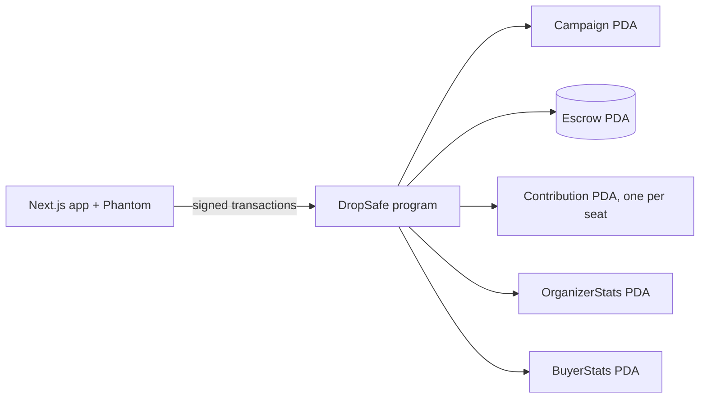
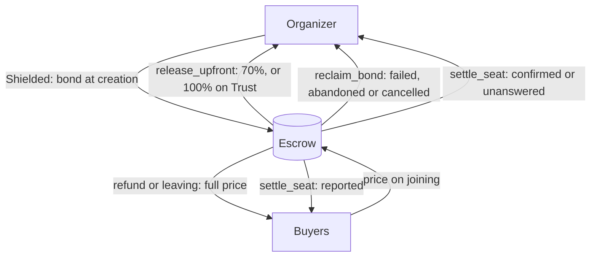
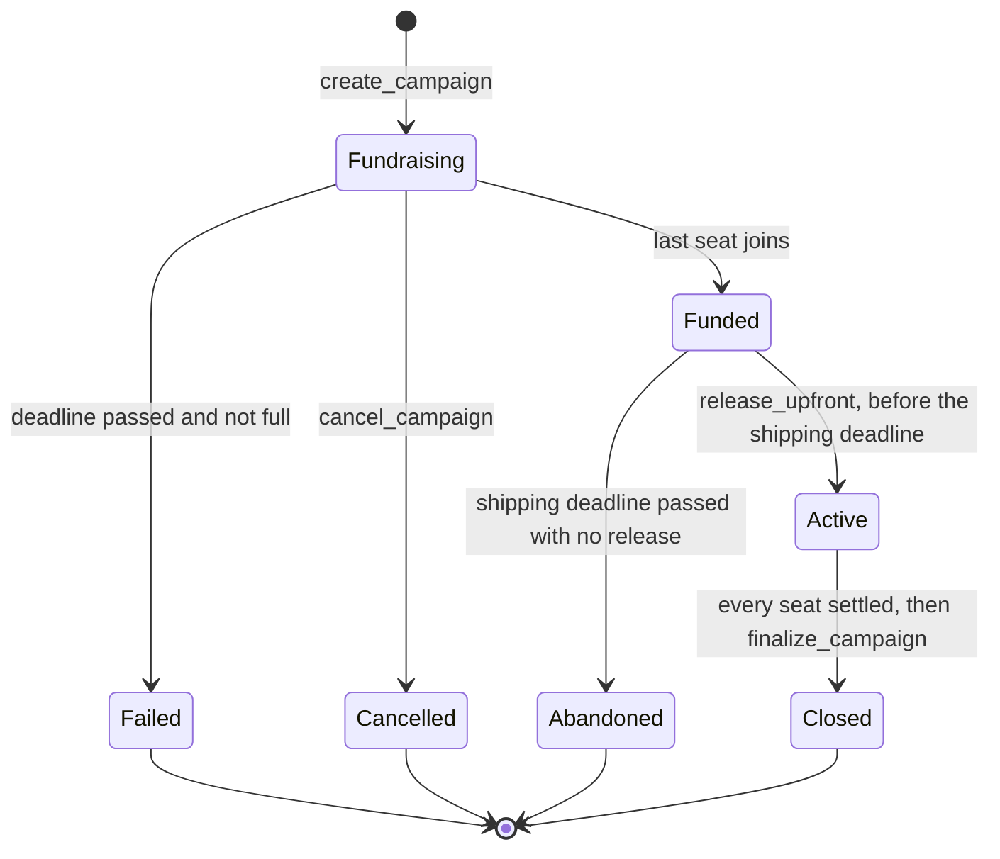
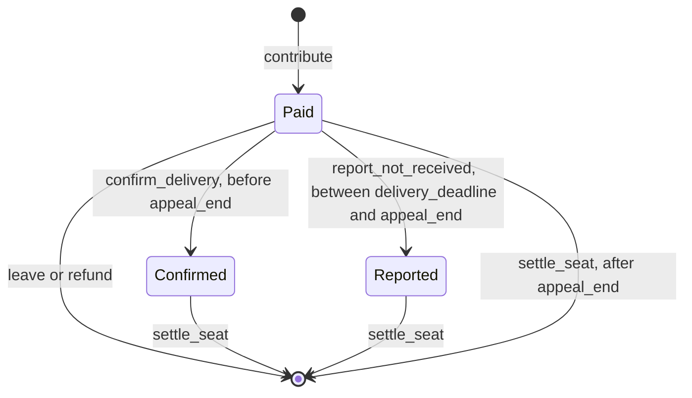

# DropSafe

**On-chain escrow for group buys on Solana, with three levels of buyer protection.** Built for the MLH Solana Hackathon (Best Beginner Hack, DeFi Track).

**Live demo (Solana Devnet):** https://dropsafe-three.vercel.app

**Devnet program (v2):** [`HPuN91VgkVKQ5kNRS79Q6kci1XJYBV9ux9fhQsQubxV2`](https://explorer.solana.com/address/HPuN91VgkVKQ5kNRS79Q6kci1XJYBV9ux9fhQsQubxV2?cluster=devnet)

This is a hackathon prototype on Devnet. It uses test SOL and has not been audited.

## The problem

Fans organize group buys for K-pop merch and limited drops every day. Buyers send money straight to the organizer's personal wallet and hope for the best. If the group never fills or the organizer disappears, getting money back depends on that same person's goodwill.

## The solution

Buyers pay into an **escrow account controlled by the program**. It has no private key, so funds move only through the program's instructions. Every group buy states its protection up front, and an organizer picks a tier when creating it. The tier can't be changed later.

| Tier | Organizer deposits at creation | Organizer receives once the group fills | A buyer who reports non-delivery gets |
| --- | --- | --- | --- |
| **Shielded** | `upfront * target_count` as a bond | `upfront * joined_count` | `remainder + upfront` from the bond, which is the full price |
| **Standard** | Nothing | `upfront * joined_count` | `remainder`, which is 30% |
| **Trust** | Nothing | `price * joined_count`, which is 100% | Nothing. The report is only recorded |

Where `upfront = price * 7 / 10` and `remainder = price - upfront`, so the two always add up to exactly `price`.

**The most a buyer can lose = the upfront share minus the bond share.** That is 0% on Shielded, 70% on Standard and 100% on Trust, provided they report during the appeal window.

Whatever the tier, every buyer takes their full payment back when:
- the group doesn't fill by the deadline,
- the organizer cancels before the group fills, or
- the group fills but the organizer doesn't withdraw before the shipping deadline.

A buyer can also leave for a full refund at any time before the group fills.

## Architecture



| Account | Seeds | Purpose |
| --- | --- | --- |
| Campaign | `"campaign", organizer, campaign_id (u64 LE)` | Terms of the group buy, including its title, description and image link |
| Escrow | `"escrow", campaign` | Holds buyer payments and the organizer's bond |
| Contribution | `"contribution", campaign, buyer` | One seat. Closed when settled, refunded or left, with rent returned to the buyer |
| OrganizerStats | `"organizer", organizer` | The organizer's record, split by tier |
| BuyerStats | `"buyer", buyer` | The buyer's record |

## Money flow



## State machines

**Campaign**



`Failed` and `Abandoned` are written by the first refund or by `finalize_campaign`, which anyone can call. The organizer's record counts each one once, even if nobody ever refunds.

**Seat**



## Rules the program enforces

- Fundraising lasts at most 90 days, and shipping at most 365 days after that.
- The appeal window is fixed by the program at 72 hours, so an organizer can't shorten it.
- Buyers can't report before the shipping deadline, which gives the organizer time to ship.
- The remainder reaches the organizer only after the buyer confirms or the appeal window ends.
- Every payout checks the escrow balance first and goes to an address fixed by the program, so anyone can safely call `settle_seat` and `finalize_campaign`.

## Threat model

| Threat | Shielded | Standard | Trust |
| --- | --- | --- | --- |
| Abusing deadlines to lock funds for years | Prevented | Prevented | Prevented |
| Setting an appeal window too short to use | Prevented | Prevented | Prevented |
| Organizer never moves forward after filling | Prevented | Prevented | Prevented |
| Organizer takes the money and runs | Prevented | Partly: buyer recovers 30% | Not prevented |
| Organizer fills seats with their own wallets | Prevented: the bond backs every seat, so a real buyer still gets the full price | Not prevented | Not prevented |
| Buyer falsely reports non-delivery | Partly, see below | Not prevented | No effect on money |
| Inflating a reputation with fake activity | Not prevented | Not prevented | Not prevented |
| Program upgrade changes the rules | Disclosed, see below | Disclosed | Disclosed |

- **False reports:** on Shielded, an organizer can check each buyer's on-chain record and choose not to ship to a suspicious buyer without losing money. If the organizer ships and the buyer still reports, the organizer loses that seat's money. The planned answer is a jury.
- **Reputation:** records are public and the organizer can't delete them, but extra wallets can inflate them. Treat them as a reference only.
- **Upgrades:** the deployer's wallet currently holds the upgrade authority, so it could change the rules. This must move to a multisig or be frozen before mainnet.
- **A filled group proves nothing:** because of extra wallets, a full group doesn't show real demand.

## Roadmap

These are planned and not built.

- **Complaint deposits and a random jury.** Buyers post a deposit to complain. Jurors are drawn with verifiable randomness (Switchboard or ORAO), weighted by stake to resist extra wallets. Jurors who vote with the minority or don't vote lose stake. If too few vote, the draw runs once more, and only then does the case default to the buyer.
- **Why a bond limits collusion.** Each seat's bond matches that seat's upfront payment, so an organizer colluding with their own wallets only moves their own money and can't take a real buyer's. What collusion can still attack is the signal from a filled group and the reputation.
- **Harder-to-fake reputation.** A protocol fee, weighting by distinct buyers and their history, and optional proof of identity such as Civic Pass.
- **Lower bonds for proven organizers**, based on their record.
- **Custom tiers** with a slider instead of three fixed levels.
- **Official delays** that extend the shipping deadline, with an exit for buyers who disagree.
- **Milestone payouts** with shipping proof hashes, and direct payment to merchants.
- **USDC** and other tokens.
- **Image hash checks**, because an image link can change today.

## Run it

You need Node.js. The app talks to the program already deployed on Devnet.

```bash
cd app
npm install
npm run dev
```

Open http://localhost:3000. In Phantom, turn on Testnet Mode and select Solana Devnet. Get Devnet SOL at https://faucet.solana.com.

The program ID and RPC URL live in [`app/src/lib/config.ts`](app/src/lib/config.ts). The app is a pixel desktop called DropSafe OS. Each feature opens in its own window, and the **View** menu switches between English and 中文.

### Build and test the program

You need Rust, the Solana CLI and Anchor 1.2.2.

```bash
cd program
npm install
npm test
```

This builds with `devnet-demo` and runs 30 tests on a local validator. They take about 4 minutes, because they wait through real deadlines and a real appeal window.

### The `devnet-demo` feature

The Devnet deployment is built with the `devnet-demo` cargo feature, which shortens the appeal window from 72 hours to 60 seconds so a full flow can be demonstrated. Nothing else changes. A build without the feature uses 72 hours:

```bash
anchor build                                   # 72-hour appeal window
anchor build -- --features devnet-demo         # 60-second appeal window, used on Devnet
```

### Known limits of the text fields

One create transaction has room for about 870 bytes of text. A title, a link and a full English description fit. A Chinese description uses three bytes per character, so the form asks for shorter text when the total won't fit.

## Earlier versions

- The tag `v1-submission` has no staged payouts. Its program is at `6KcTuoAX6u5SRdX563VhbrXWiBrMwAfGxST5ud9RaQgX`.
- The 70/30 version without tiers is at `6Sno3DHv8uPp9aER9hhdToEnKFLHZwzJZjMNX5GnDj8u`.

## Tech stack

Anchor (Rust) · Solana Devnet · Next.js App Router · TypeScript · Tailwind CSS · Solana Wallet Adapter (Phantom)
