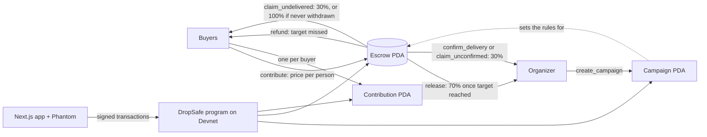
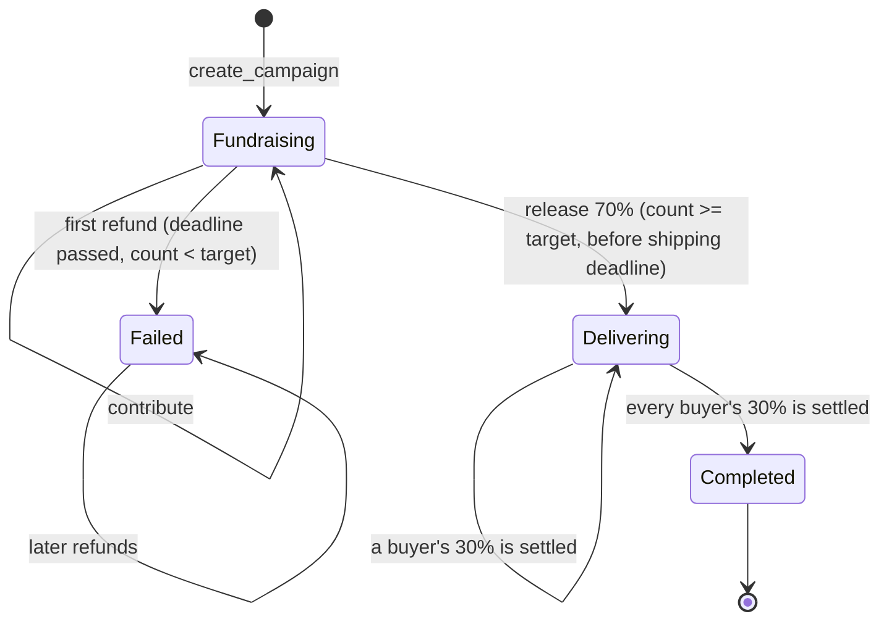

# DropSafe

**On-chain escrow for group buys on Solana.** Built for the MLH Solana Hackathon (Best Beginner Hack, DeFi Track).

**Live demo (Solana Devnet):** https://dropsafe-three.vercel.app

Devnet program: [`6Sno3DHv8uPp9aER9hhdToEnKFLHZwzJZjMNX5GnDj8u`](https://explorer.solana.com/address/6Sno3DHv8uPp9aER9hhdToEnKFLHZwzJZjMNX5GnDj8u?cluster=devnet)

## The problem

Fans organize group buys for K-pop merch and limited drops every day. Buyers send money straight to the organizer's personal wallet and hope for the best. If the organizer disappears, the money is gone, and if the order never fills, getting a refund depends on that same person's goodwill.

## The solution

DropSafe puts the money somewhere the organizer can't touch until the deal is on:

- Buyers pay into an **escrow account controlled by the program**. It has no private key, so nobody can move the funds outside the rules.
- **Target missed by the deadline:** every buyer takes their own SOL back, without asking anyone.
- **Target reached:** the organizer can withdraw **70%** to place the order. The other **30%** stays in escrow.
- **Goods arrive:** a buyer confirms delivery, and their 30% goes to the organizer.
- **Goods don't arrive:** after the shipping deadline, a buyer can report it during the dispute window and take their 30% back.
- **No complaint:** after the dispute window closes, the organizer can claim the shares nobody disputed.
- **Organizer never withdraws:** after the shipping deadline, every buyer can take back their full payment, so funds never get stuck.

## Architecture



| Account | Seeds | Purpose |
| --- | --- | --- |
| Campaign | `"campaign", organizer, campaign_id (u64 LE)` | Title, price, target, deadline, count, status |
| Escrow | `"escrow", campaign` | Holds the buyers' SOL |
| Contribution | `"contribution", campaign, buyer` | Proves a buyer joined and how much they can reclaim. Created once, so nobody can join twice. Closed when settled, so nobody can be paid twice |

## State machine



The chain only writes `Failed` on the first refund. The app works out what a campaign is really doing from the clock too, such as showing it as failed as soon as the deadline passes with too few buyers. If an organizer never withdraws, buyers refund in full and the campaign stays in `Fundraising` on-chain, while the app shows "Not withdrawn · refunds open".

## Instructions

| Instruction | Who | Rules |
| --- | --- | --- |
| `create_campaign` | Organizer | Title ≤ 50 characters, price > 0, target > 0, deadline in the future, then shipping deadline, then dispute deadline |
| `contribute` | Buyer | Fundraising, before the deadline, not full, once per wallet |
| `refund` | Buyer | Deadline passed and target missed |
| `release` | Organizer | Target reached, not released yet, before the shipping deadline. Pays 70% |
| `confirm_delivery` | Buyer | After release. Pays that buyer's 30% to the organizer |
| `claim_undelivered` | Buyer | After the shipping deadline. Returns 30% during the dispute window, or the full payment if the organizer never withdrew |
| `claim_unconfirmed` | Organizer | After the dispute window. Pays the organizer one undisputed 30% share |

Solana programs can't run on a timer, so "released automatically after the dispute window" means the organizer sends a transaction to claim it. The app translates custom errors into plain Chinese and English.

## Run it

You need Node.js. The app talks to the program already deployed on Devnet.

```bash
cd app
npm install
npm run dev
```

Open http://localhost:3000, and in Phantom turn on Testnet Mode and select Solana Devnet. Get Devnet SOL at https://faucet.solana.com.

### Build and test the program

You need Rust, the Solana CLI and Anchor 1.2.2.

```bash
cd program
npm install
npm test
```

This runs 27 tests on a local validator. `npm test` runs `anchor test --validator legacy`, because Anchor 1.x otherwise expects Surfpool.

### Configuration

The program ID and RPC URL live in [`app/src/lib/config.ts`](app/src/lib/config.ts).

## Known limits

This is a hackathon prototype on Devnet and has not been audited. Staged payouts cap the damage rather than remove it:

- An organizer who runs off after withdrawing still keeps the 70%. Buyers can only recover the 30%.
- A dishonest buyer can report non-delivery after receiving their goods and keep the 30%. There is no arbitration yet.
- An organizer can fill their own campaign using several wallets.

About 0.001 SOL of rent paid by the organizer stays in each escrow account.

## Versions

The tag `v1-submission` is the earlier version, without staged payouts. Its program is still on Devnet at `6KcTuoAX6u5SRdX563VhbrXWiBrMwAfGxST5ud9RaQgX`.

## Future Work

- Dispute handling and arbitration
- Organizer deposits
- USDC and other SPL tokens

## Tech stack

Anchor (Rust) · Solana Devnet · Next.js App Router · TypeScript · Tailwind CSS · Solana Wallet Adapter (Phantom)
