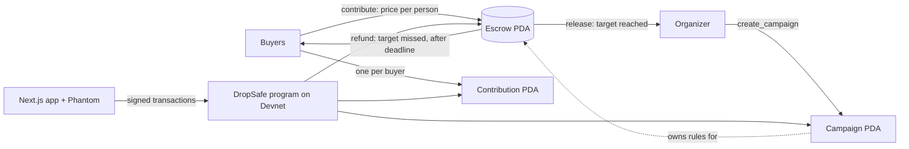
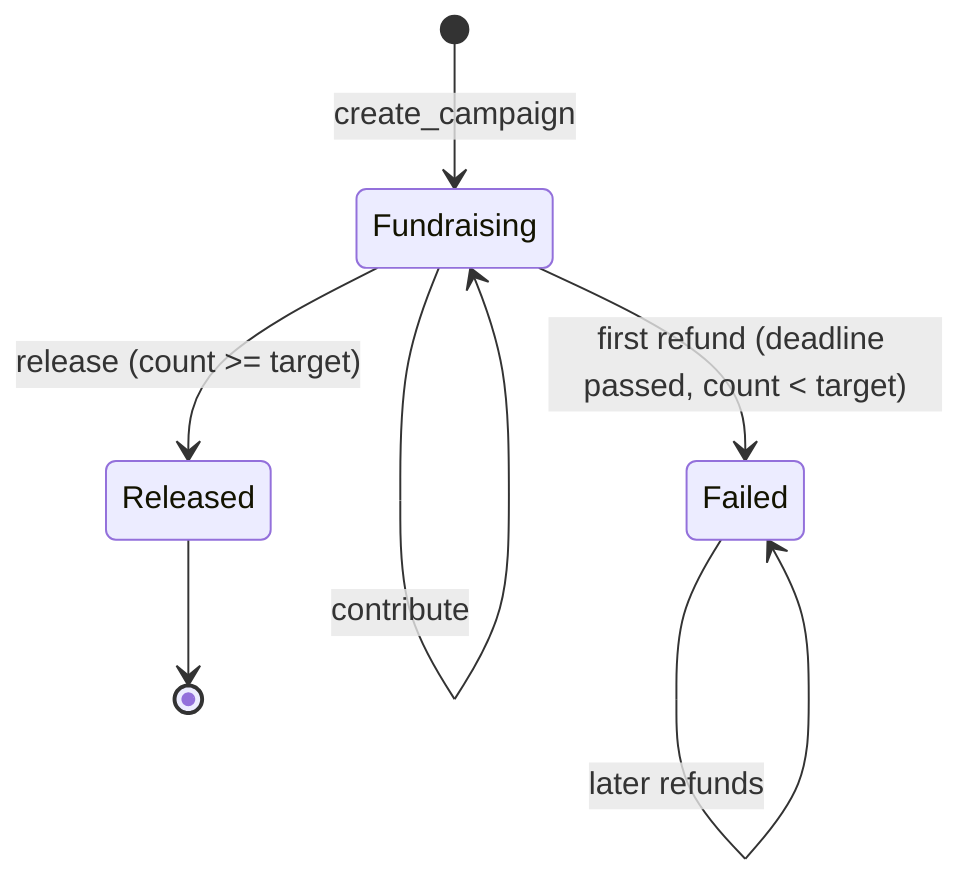

# DropSafe

**On-chain escrow for group buys on Solana.** Built for the MLH Solana Hackathon (Best Beginner Hack, DeFi Track).

Devnet program: [`6KcTuoAX6u5SRdX563VhbrXWiBrMwAfGxST5ud9RaQgX`](https://explorer.solana.com/address/6KcTuoAX6u5SRdX563VhbrXWiBrMwAfGxST5ud9RaQgX?cluster=devnet)

## The problem

Fans organize group buys for K-pop merch and limited drops every day. Buyers send money straight to the organizer's personal wallet and hope for the best. If the organizer disappears, the money is gone, and if the order never fills, getting a refund depends on that same person's goodwill.

## The solution

DropSafe puts the money somewhere the organizer can't touch until the deal is on:

- Buyers pay into an **escrow account controlled by the program**. It has no private key, so nobody can move the funds outside the rules.
- **Target missed by the deadline:** every buyer takes their own SOL back, without asking anyone.
- **Target reached:** only then can the organizer withdraw.

## Architecture



| Account | Seeds | Purpose |
| --- | --- | --- |
| Campaign | `"campaign", organizer, campaign_id (u64 LE)` | Title, price, target, deadline, count, status |
| Escrow | `"escrow", campaign` | Holds the buyers' SOL |
| Contribution | `"contribution", campaign, buyer` | Proves a buyer joined and how much they can reclaim. Created once, so nobody can join twice. Closed on refund, so nobody can refund twice |

## State machine



The chain only writes `Failed` on the first refund. The app also shows a campaign as failed as soon as the deadline passes with too few buyers, and as "Target reached" while it waits for the organizer to withdraw.

## Instructions

| Instruction | Who | Rules |
| --- | --- | --- |
| `create_campaign` | Organizer | Title ≤ 50 characters, price > 0, target > 0, deadline in the future |
| `contribute` | Buyer | Fundraising, before the deadline, not full, once per wallet |
| `refund` | Buyer | Deadline passed and target missed |
| `release` | Organizer | Target reached, not released yet |

Custom errors include `DeadlinePassed`, `CampaignFull`, `NotOrganizer`, `TargetNotReached`, `AlreadyReleased` and `CampaignStillActive`. The app translates them into plain Chinese and English.

## Run it

You need Node.js. The app talks to the program already deployed on Devnet.

```bash
cd app
npm install
npm run dev
```

Open http://localhost:3000, and in Phantom turn on Testnet Mode and select Solana Devnet. Get Devnet SOL at https://faucet.solana.com.

### Build and test the program

You need Rust, the Solana CLI and Anchor 1.2.2.

```bash
cd program
npm install
npm test
```

This runs 17 tests on a local validator. `npm test` runs `anchor test --validator legacy`, because Anchor 1.x otherwise expects Surfpool.

### Configuration

The program ID and RPC URL live in [`app/src/lib/config.ts`](app/src/lib/config.ts).

## Known limits

This is a hackathon prototype on Devnet and has not been audited. Reaching the target releases the money before any goods are delivered, and an organizer could fill their own campaign using several wallets. Escrow protects buyers from a campaign that never fills, but not yet from an organizer who collects the funds and never ships. The first two Future Work items address this.

About 0.001 SOL of rent paid by the organizer stays in each escrow account after release, so that a repeated release fails with a clear `AlreadyReleased` error.

## Future Work

- Buyer confirmation of delivery before funds are released
- Staged payouts to the organizer
- Dispute handling
- Organizer deposits
- USDC and other SPL tokens

## Tech stack

Anchor (Rust) · Solana Devnet · Next.js App Router · TypeScript · Tailwind CSS · Solana Wallet Adapter (Phantom)
